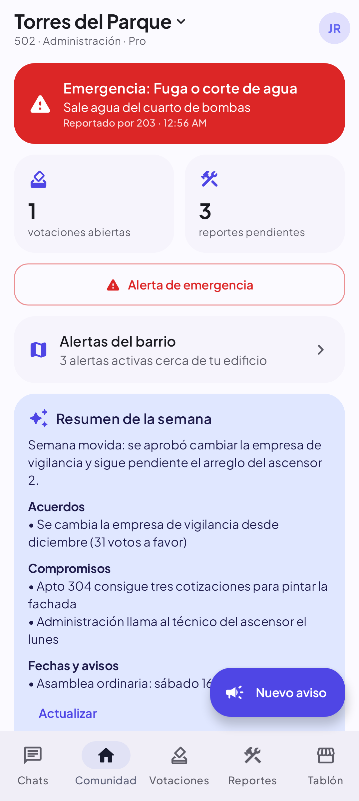
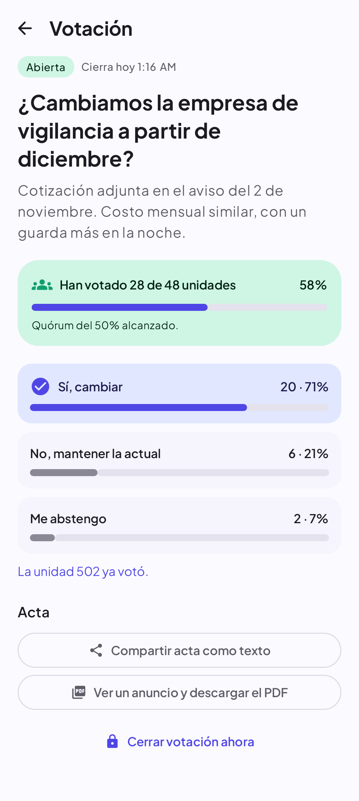
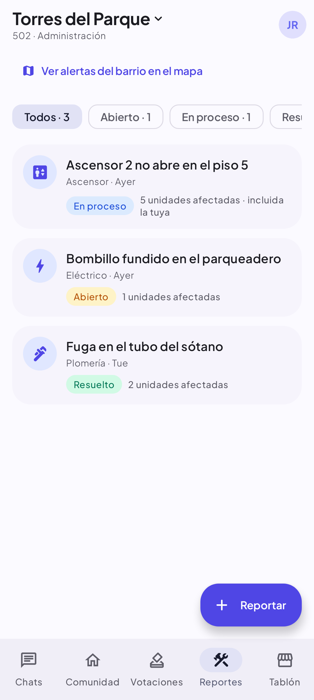
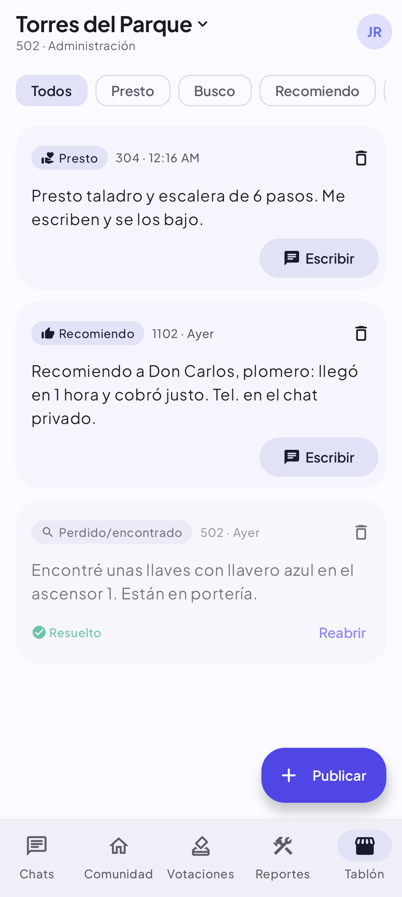

# Chat SimpApp · Tu edificio, organizado

App Android para **comunidades de vecinos** (edificios y conjuntos residenciales). No compite con WhatsApp: resuelve
lo que los grupos de WhatsApp del edificio hacen mal.

<p>
  
  
  
  
</p>

## Qué problema resuelve

| En el grupo de WhatsApp del edificio… | En Chat SimpApp |
|---|---|
| Los avisos importantes se pierden entre memes y discusiones | **Avisos oficiales** separados del chat, fijables, con "visto por N" |
| Votar es contar "👍" a mano; votan dos del mismo apto | **Votaciones con un voto por unidad**, quórum automático y **acta** (texto o PDF) |
| "¿Ya arreglaron el ascensor?" × 40 mensajes | **Reportes con estado** (abierto → en proceso → resuelto) y "a mí también me afecta" |
| Quien administra el grupo saca a quien quiera | Unirse con **código**; el canal oficial no depende de un administrador de grupo |
| Tu número queda expuesto a 200 personas | Te identificas por **tu unidad**; chats privados sin compartir teléfono |
| Nadie lee 300 mensajes | **Resumen semanal con IA**: acuerdos, compromisos y fechas |
| Una fuga de gas se avisa igual que un meme | **Alerta de emergencia** con sonido de alarma para todo el edificio |
| Lo que pasa en la calle no le llega a los edificios vecinos | **Alertas del barrio**: mapa simple con lo que reportan los vecinos de los edificios cercanos |
| Préstamos y recomendaciones se pierden | **Tablón**: presto, busco, recomiendo, perdido/encontrado, vendo |

El **chat es lo principal**: es la primera pestaña y la que se abre. Las alertas del barrio no tienen pestaña
propia: se abren desde una tarjeta en "Comunidad" y desde "Reportes".

### Alertas del barrio (mapa)
- **MapLibre + OpenFreeMap** (datos de OpenStreetMap): gratis, sin clave ni tarjeta, estilo claro y simple. El crédito de OpenStreetMap se muestra siempre (botón ⓘ).
- Pensado para personas mayores: pines grandes, 3 colores siempre con ícono y palabra, distancias en cuadras,
  tiempos en palabras ("hace 20 minutos"), botones grandes de zoom (+/−), "Volver a mi casa" y la misma información en lista.
- Reportar en 2 pasos: "¿Qué pasó?" (6 botones grandes) y "¿Fue aquí?" (se mueve el mapa, el pin queda fijo).
- Se reportan hechos, no personas: no existe "persona sospechosa". Ubicación redondeada a ~11 m.
- "Yo también lo vi" confirma; si varios dicen "Ya no está", se oculta. Robos: 12 h; daños: hasta 30 días.
- Radio de 2 km alrededor del edificio; no se puede alejar más de ~5 km. Búsqueda por cercanía con geohash.
- Solo las alertas de seguridad envían notificación; las demás se ven en el mapa sin sonar.

Además conserva el chat general del edificio, chats privados y grupos (texto, últ. vez,
leído). El chat general **no envía notificaciones push** a propósito: es el ruido que los vecinos quieren evitar.
Avisos, emergencias, votaciones y cambios en tus reportes sí notifican.

## Cómo gana dinero

### Plan gratuito: anuncios (4 formatos)

| Formato | Dónde | Límite | Pago aprox. en LATAM (Android, por 1000 vistas) |
|---|---|---|---|
| **Apertura** (App Open) | Al volver a la app tras 2+ min fuera | 1 cada 4 h | sin dato público; suele pagar menos que el intersticial |
| **Intersticial** | Después de publicar algo o al salir de una votación/reporte | 1 cada 3 min, máx. 6 al día | ~US$1,30–1,90 |
| **Recompensa** | El vecino lo elige para descargar un acta en PDF | cuando quiera | ~US$1,80–2,00 |
| **Banner** | Abajo en Inicio, Votaciones, Reportes y Tablón | siempre visible | ~US$0,12–0,15 |

Nunca hay anuncios dentro de un chat, al lanzar una emergencia ni en la primera apertura de la app.
Los límites están en [`AdsController`](app/src/main/java/com/jonathan/chatsimpapp/ads/AdsController.kt);
un vecino molesto desinstala, y sin vecinos no hay negocio. Si los ingresos lo justifican, se pueden ajustar.

### Comunidad Pro: suscripción por tamaño de edificio

La paga la administración y quita **todos** los anuncios para todos los vecinos, además de dar resumen IA, actas PDF
sin anuncios, votaciones ilimitadas y confirmación de lectura. El precio va por rangos de unidades (planes base de
la misma suscripción en Google Play):

| Rango | Plan base | Precio sugerido | Anual |
|---|---|---|---|
| hasta 30 unidades | `u30-mensual` / `u30-anual` | US$5,99/mes | US$59,90 |
| 31–80 | `u80-…` | US$12,99/mes | US$129,90 |
| 81–200 | `u200-…` | US$34,99/mes | US$349,90 |
| 201–500 | `u500-…` | US$79,99/mes | US$799,90 |
| más de 500 | `u5000-…` | US$149,99/mes | US$1.499,90 |

Un edificio de 50 y otro de 60 unidades caen en el mismo rango y pagan igual. La app muestra automáticamente el
rango correcto. Si el edificio crece por encima del rango pagado, Pro se desactiva hasta subir de plan (lo validan
la app, las reglas y el servidor). Bajar el número de unidades para pagar menos no conviene: el quórum de las
votaciones se calcula con ese número.

### ¿Las cuentas dan? (por vecino activo al mes)

| | Supuesto | Valor |
|---|---|---|
| Apertura | ~1,5 al día × 30 × ~US$1,0/1000 | US$0,045 |
| Intersticial | ~2 al día × 30 × ~US$1,5/1000 | US$0,09 |
| Banner | ~10 al día × 30 × ~US$0,13/1000 | US$0,04 |
| Recompensa | ~2 al mes × ~US$1,9/1000 | US$0,004 |
| **Ingreso por anuncios** | con ~70 % de anuncios servidos | **≈ US$0,13** |
| **Costo de servidor** | Firebase Spark + Cloudflare gratis | **US$0** (hasta los límites gratis) |

- **Edificio de 50 vecinos en plan gratuito**: ≈ US$6,50 de anuncios; el servidor es gratis.
- **Edificio de 60**: ≈ US$7,80. Los dos dejan ganancia.
- **El mismo edificio en Pro (rango hasta 80)**: US$12,99 − 15 % de Google = US$11,04 netos, más que los anuncios
  de un edificio lleno de ese rango (80 × 0,13 = US$10,40). Por eso los precios de arriba: pasar a Pro nunca te hace
  perder frente a los anuncios.
- **Riesgos**: no todos los apartamentos instalan la app (cuenta con 40–70 % al principio), el pago real de los
  anuncios depende del país y de la época del año (sube en noviembre y diciembre), y estos promedios vienen de
  informes de empresas de publicidad. Usa el panel de AdMob para ajustar con tus datos reales.

**En resumen: cada vecino deja unas 25 veces lo que cuesta.** Lo que más hay que vigilar no es el costo, sino que
la gente instale la app y la use. El código además protege el costo: listas con tope, paginación de mensajes,
sin subida de archivos, el resumen IA se genera una vez por semana y lo leen todos, y App Check impide que alguien
use tu Firebase desde fuera de la app.

Otras ideas para después: precio especial para administradoras que manejan varios edificios, reserva de zonas
comunes (salón, BBQ) como función Pro, y un panel web para la administración.

## Backend (esquema nuevo de RJ2)

Firebase queda en **plan Spark (gratis, sin cuenta de facturación)** y todo lo que en Firebase pediría Blaze va en
**Cloudflare** (cuenta rj2techsolutions@gmail.com, plan gratis).

| Pieza | Dónde | Notas |
|---|---|---|
| Login con Google, Firestore, Remote Config, App Check, AI Logic (Gemini), Hosting (legales) | Firebase Spark | Firestore gratis: ~50.000 lecturas y 20.000 escrituras al día |
| Notificaciones push, tokens FCM, "últ. vez", webhook y sincronización de RevenueCat | Worker `chat-simpapp-api` + D1 `chat-simpapp` (carpeta [`server/`](server)) | https://chat-simpapp-api.rj2techsolutions.workers.dev |
| Tareas programadas (borrar alertas vencidas, limpiar D1) | Worker compartido `rj2-cron` | Esta app no crea Cron Triggers propios |

**Qué se quitó por no existir o no caber en Spark:**
- **Cloud Functions** → Worker de Cloudflare. Firestore no puede llamar al Worker, así que la app le avisa justo
  después de publicar; el Worker comprueba en Firestore que lo publicado existe y es de quien llama.
- **Storage** → la app no sube fotos (chat, reportes, tablón, grupos). La foto de perfil es la de Google.
- **Realtime Database** (100 conexiones simultáneas) → "últ. vez" en D1; sin "escribiendo…" en vivo.
- **TTL de Firestore** → tarea `cleanup-alerts` de `rj2-cron`.
- **Google Maps** (pide cuenta de facturación) → MapLibre + OpenFreeMap.
- **Login con correo/contraseña** → solo Google (regla de RJ2 para comprar; más simple para personas mayores).

**Notificaciones:** chats privados y grupos van a los tokens de cada miembro (D1). Todo lo de la comunidad va a
**temas FCM** (`c_<comunidad>` y `c_<comunidad>_u_<unidad>`): un solo envío aunque el edificio tenga 300 vecinos
(el plan gratis de Workers permite 50 subpeticiones por invocación). El chat general del edificio no notifica.

**⚠️ Límite de crecimiento:** con unas 300 lecturas por vecino activo al día, Firestore Spark alcanza para
**~150 personas usando la app el mismo día**. Al pasarse, Firestore deja de responder hasta la medianoche
(hora del Pacífico); no cobra, pero la app se cae. Cuando se acerque: mover los mensajes del chat a Cloudflare
(D1/Durable Objects) o reconsiderar Blaze. Revisar el uso en Firebase → Firestore → Uso.

## Puesta en marcha

La lista completa y ordenada está en **[PENDIENTES.md](PENDIENTES.md)**. Resumen:

1. **Firebase (rj2techsolutions@gmail.com, plan Spark):** proyecto nuevo, app Android
   `com.rj2techsolutions.chatsimpapp`, login con Google + SHA-1, Firestore, App Check, AI Logic, Remote Config.
   `firebase deploy --only firestore,hosting`.
2. **Cloudflare:** el Worker ya está desplegado. Faltan las variables `FIREBASE_PROJECT_ID` y
   `FIREBASE_PROJECT_NUMBER` (en `server/wrangler.toml`) y los secretos:
   ```bash
   cd server
   npx wrangler secret put FIREBASE_SERVICE_ACCOUNT   # JSON de la cuenta de servicio de Firebase
   npx wrangler secret put REVENUECAT_SECRET_KEY      # clave secreta v1 de RevenueCat (sk_…)
   npx wrangler secret put REVENUECAT_WEBHOOK_AUTH    # texto largo inventado, igual que en RevenueCat
   npx wrangler secret put CRON_SECRET                # clave que usará rj2-cron
   npx wrangler deploy
   ```
3. **rj2-cron:** registrar `POST https://chat-simpapp-api.rj2techsolutions.workers.dev/cron/cleanup-alerts`
   (cada hora) y `/cron/cleanup-db` (una vez al día), con el header `X-Cron-Secret: <CRON_SECRET>`.
4. **RevenueCat (rj2techsolutions@gmail.com):** entitlement `pro`; offerings `u30`, `u80`, `u200`, `u500`,
   `u5000` con paquetes mensual y anual; webhook a
   `https://chat-simpapp-api.rj2techsolutions.workers.dev/webhooks/revenuecat` con el mismo valor de
   `REVENUECAT_WEBHOOK_AUTH` en *Authorization header*. Clave `goog_…` en `~/.gradle/gradle.properties` como
   `revenueCatApiKey`.
5. **Play Console:** suscripción `comunidad_pro` con planes base `u30-mensual`, `u30-anual`, … `u5000-anual`.
6. **AdMob:** 4 bloques (banner, apertura, intersticial, recompensado) en `~/.gradle/gradle.properties`.

Antes de publicar: `./scripts/check-release.sh`.

## Actualización obligatoria

Cuando se publica una versión nueva en Google Play, la app obliga a actualizar al abrirse (Play In-App Updates,
modo IMMEDIATE) y no deja usarla con la versión vieja. Como respaldo, el parámetro `min_version_code` de Remote
Config bloquea versiones antiguas. Es una regla del proyecto: ver [CLAUDE.md](CLAUDE.md).

## Seguridad

Las reglas de [`firestore.rules`](firestore.rules) impiden, entre otras cosas, que alguien: lea una comunidad de la
que no es miembro, se una sin el código vigente, vote dos veces o por otra unidad, vote después del cierre, publique
avisos oficiales sin ser administración, cambie el estado de un reporte, o **se active el plan Pro sin pagar** (solo
el Worker de Cloudflare, tras consultar RevenueCat, puede escribir el plan).

Están probadas contra el emulador: `cd rules-tests && npm install && npm test` (19 pruebas).

> ⚠️ La antigua *server key* de FCM de la versión 1 quedó en el historial de git. Ya no sirve con la API nueva,
> pero revócala en Configuración del proyecto → Cloud Messaging.

## Arquitectura

```
app/src/main/java/com/jonathan/chatsimpapp/
├── data/model          Comunidad, miembro, aviso, votación, reporte, publicación, chat, mensaje
├── data/repository     Firebase como Flow/suspend; CommunitySession = comunidad seleccionada
├── ai                  Resumen semanal con Gemini (Firebase AI Logic)
├── billing             RevenueCat (la activación del plan la hace el Worker)
├── data/remote         Cliente del Worker de Cloudflare
├── ads                 AdMob + consentimiento UMP
├── config              Remote Config (modelo de IA, límites del plan gratuito)
├── notifications       FCM: chats, avisos, emergencias (canal con alarma)
├── ui/…                Pantallas Compose + ViewModels
└── util                Quórum, códigos de invitación, fechas, PDF del acta
server/                 Worker de Cloudflare (TypeScript): notificaciones, RevenueCat, tareas programadas
hosting/                Páginas legales (Firebase Hosting)
rules-tests/            Pruebas de las reglas de seguridad
```

Kotlin 2.2, Jetpack Compose + Material 3, Hilt, corrutinas/Flow, Navigation con rutas tipadas, MapLibre.

### Datos

| Ruta | Contenido |
|---|---|
| `communities/{id}` | nombre, unidades, código, administración, plan |
| `communities/{id}/members/{uid}` | unidad y rol |
| `communities/{id}/announcements` | avisos y emergencias (+ `reads` para "visto por") |
| `communities/{id}/polls/{pid}/votes/{unidad}` | un documento por unidad = un voto por unidad |
| `communities/{id}/reports`, `posts`, `summaries` | reportes, tablón, resúmenes IA |
| `invites/{código}` | a qué comunidad lleva cada código |
| `alerts/{id}` | alertas del barrio: tipo, ubicación, geohash, vencimiento, confirmaciones |
| `chats/{id}` | chat general (mismo id que la comunidad), privados y grupos |

## Pruebas

```bash
./gradlew testDebugUnitTest          # lógica (quórum, códigos, fechas…) + capturas de pantalla
cd server && npm test                # Worker de Cloudflare
./gradlew recordRoborazziDebug       # regenera las capturas de /screenshots
cd rules-tests && npm test           # reglas de seguridad en el emulador
```
