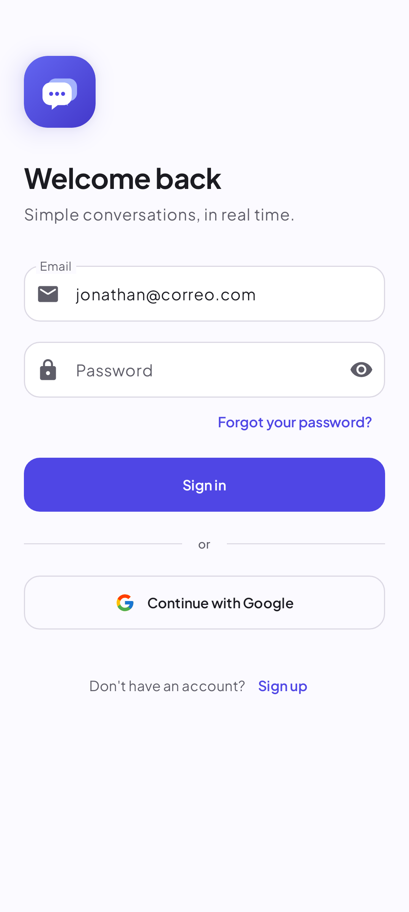
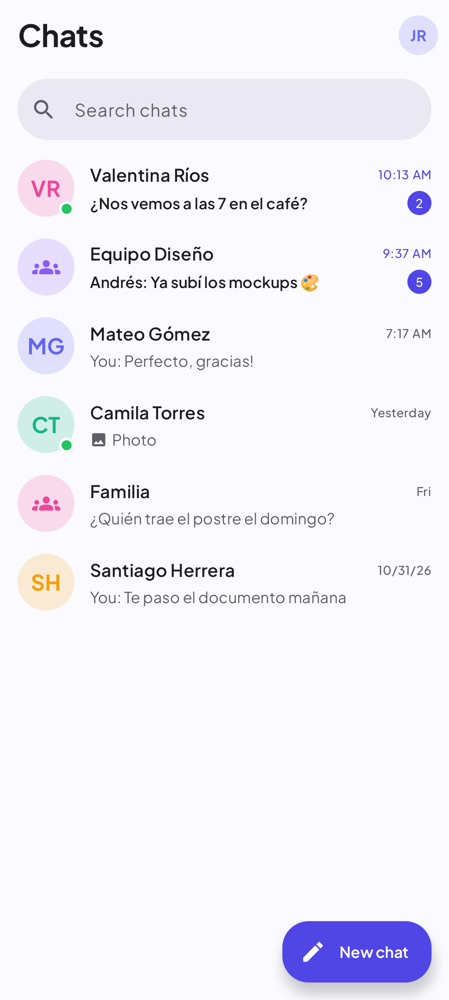
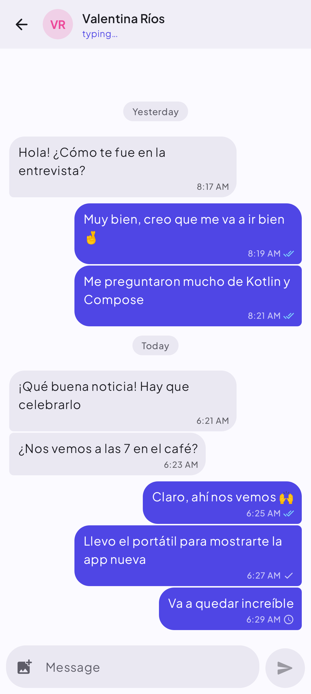
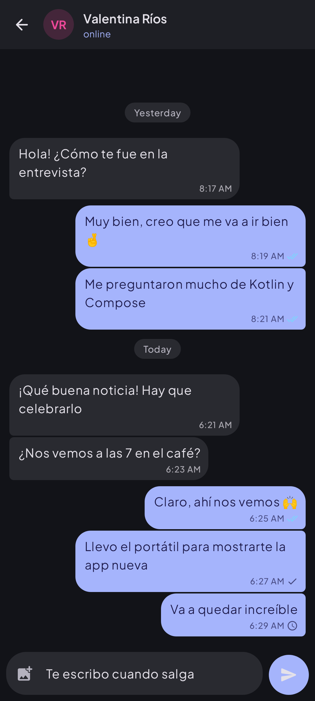

# Chat SimpApp

App de chat en tiempo real para Android, hecha con **Kotlin, Jetpack Compose y Material 3** sobre **Firebase**.

<p>
  
  
  
  
</p>

## Funciones

- Registro e inicio de sesión con correo/contraseña o **Google** (Credential Manager) y recuperación de contraseña.
- Chats 1 a 1 y **grupos** con foto y nombre.
- Mensajes de texto e **imágenes** (comprimidas antes de subir).
- Estado **en línea / últ. vez** y **"escribiendo…"** en tiempo real.
- Checks de **enviado / leído** y contador de **no leídos** por chat.
- Funciona **sin conexión**: los mensajes aparecen al instante y se envían al volver la red.
- **Notificaciones push** agrupadas por conversación (con Cloud Function).
- Perfil editable (foto, nombre, info), **modo oscuro** automático, español e inglés.

## Arquitectura

```
app/src/main/java/com/jonathan/chatsimpapp/
├── data/model         Modelos de Firestore (User, Chat, Message, Presence)
├── data/repository    Acceso a Firebase expuesto como Flow/suspend (Auth, User, Chat, Presence)
├── di                 Módulos de Hilt
├── notifications      Servicio FCM y construcción de notificaciones
├── ui/<pantalla>      Pantalla Compose + ViewModel (estado inmutable con StateFlow)
├── ui/components      Componentes reutilizables (Avatar, botones, búsqueda…)
├── ui/theme           Colores, tipografía (Plus Jakarta Sans) y formas
└── util               Utilidades puras (fechas, validaciones, ids)
```

MVVM + repositorios, inyección con Hilt, corrutinas y Flow, Navigation Compose con rutas tipadas.

### Modelo de datos

| Dónde | Ruta | Contenido |
|---|---|---|
| Firestore | `users/{uid}` | nombre, correo, foto, info |
| Firestore | `users/{uid}/private/fcm` | tokens de notificación (privado) |
| Firestore | `chats/{chatId}` | miembros, tipo, último mensaje, no leídos, última lectura |
| Firestore | `chats/{chatId}/messages/{id}` | remitente, texto, imagen, fecha |
| Realtime DB | `status/{uid}` | en línea / desconectado (con `onDisconnect`) |
| Realtime DB | `typing/{chatId}/{uid}` | quién está escribiendo |

Los chats 1 a 1 usan un id fijo (`uidA_uidB` ordenados), así nunca se duplican.

## Puesta en marcha

1. Abre el proyecto en Android Studio (Ladybug o más reciente, JDK 17+).
2. En la [consola de Firebase](https://console.firebase.google.com/) del proyecto `chat-simpapp`:
   - **Authentication** → habilita *Correo/contraseña* y *Google*.
   - **Configuración del proyecto** → agrega la **huella SHA-1** de tu llave de depuración
     (`./gradlew signingReport`) y vuelve a descargar `google-services.json` a `app/`.
     Sin la SHA-1, el inicio con Google falla.
   - Crea **Firestore**, **Realtime Database** y **Storage** si no existen.
3. Publica reglas e índices (requiere [Firebase CLI](https://firebase.google.com/docs/cli)):
   ```bash
   firebase login
   firebase use chat-simpapp
   firebase deploy --only firestore,database,storage
   ```
4. Ejecuta la app: `./gradlew installDebug`.

### Notificaciones push

La versión anterior enviaba notificaciones desde el teléfono con la *server key* de FCM. Esa API fue
**apagada por Google en junio de 2024** y, además, la clave quedaba expuesta en el código. Ahora las
envía la Cloud Function de [`functions/index.js`](functions/index.js) cuando se crea un mensaje:

```bash
cd functions && npm install && cd ..
firebase deploy --only functions
```

Cloud Functions requiere el plan **Blaze** (pago por uso; el nivel gratuito cubre de sobra una app pequeña).
Sin la función la app funciona igual, solo que sin notificaciones push.

> ⚠️ La antigua server key quedó en el historial de git. Aunque ya no sirve con la API nueva, revócala en
> *Configuración del proyecto → Cloud Messaging*.

## Pruebas

```bash
./gradlew testDebugUnitTest              # pruebas unitarias + capturas
./gradlew recordRoborazziDebug           # regenerar capturas en /screenshots
```

Las capturas de `screenshots/` se generan con Roborazzi (Robolectric), sin emulador.

## Migración desde la versión 1

- Los usuarios existentes pueden iniciar sesión con la misma cuenta; su nombre y foto se copian
  de la colección vieja `UsersRegister` la primera vez.
- Los chats y mensajes antiguos (`Chats`, `Messages`) **no** se migran porque el esquema cambió.
- Se quitaron Facebook Login, AdMob y la sección "Rates".
