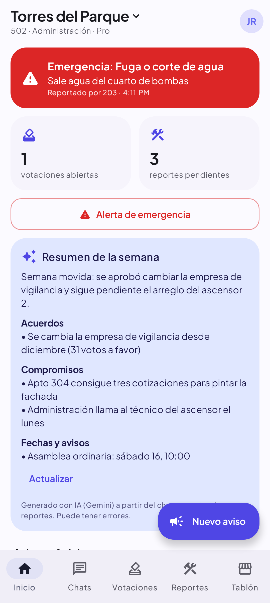
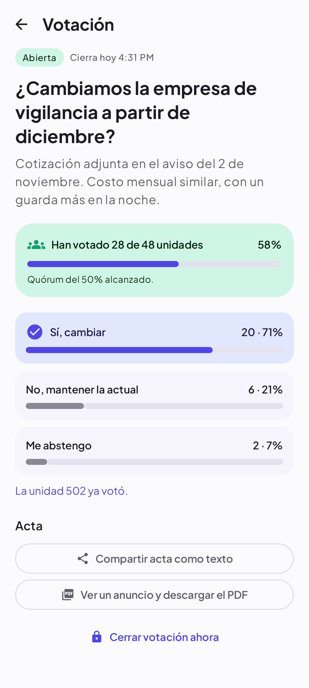
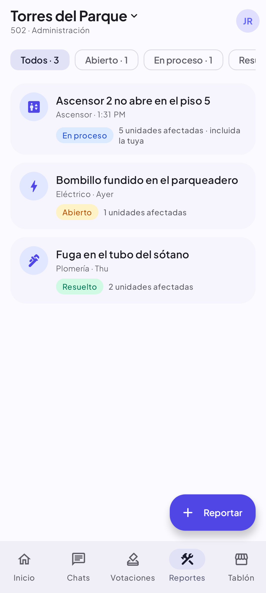
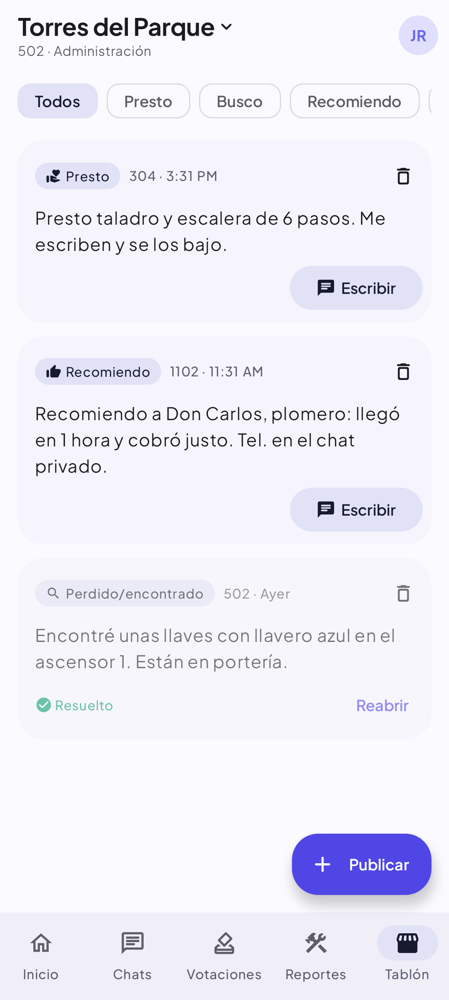

# Chat SimpApp · Tu edificio, organizado

App Android para **comunidades de vecinos** (edificios y conjuntos residenciales). No compite con WhatsApp: resuelve
lo que los grupos de WhatsApp del edificio hacen mal.

<p>
  
  
  
  
</p>

## Qué problema resuelve

| En el grupo de WhatsApp del edificio… | En Chat SimpApp |
|---|---|
| Los avisos importantes se pierden entre memes y discusiones | **Avisos oficiales** separados del chat, fijables, con "visto por N" |
| Votar es contar "👍" a mano; votan dos del mismo apto | **Votaciones con un voto por unidad**, quórum automático y **acta** (texto o PDF) |
| "¿Ya arreglaron el ascensor?" × 40 mensajes | **Reportes con foto y estado** (abierto → en proceso → resuelto) y "a mí también me afecta" |
| Quien administra el grupo saca a quien quiera | Unirse con **código**; el canal oficial no depende de un administrador de grupo |
| Tu número queda expuesto a 200 personas | Te identificas por **tu unidad**; chats privados sin compartir teléfono |
| Nadie lee 300 mensajes | **Resumen semanal con IA**: acuerdos, compromisos y fechas |
| Una fuga de gas se avisa igual que un meme | **Alerta de emergencia** con sonido de alarma para todo el edificio |
| Préstamos y recomendaciones se pierden | **Tablón**: presto, busco, recomiendo, perdido/encontrado, vendo |

Además conserva el chat general del edificio, chats privados y grupos (texto e imágenes, en línea, escribiendo,
leído). El chat general **no envía notificaciones push** a propósito: es el ruido que los vecinos quieren evitar.
Avisos, emergencias, votaciones y cambios en tus reportes sí notifican.

## Cómo gana dinero

### Plan gratuito: anuncios (4 formatos)

| Formato | Dónde | Límite | Pago aprox. en LATAM (Android, por 1000 vistas) |
|---|---|---|---|
| **Apertura** (App Open) | Al volver a la app tras 2+ min fuera | 1 cada 4 h | sin dato público; suele pagar menos que el intersticial |
| **Intersticial** | Después de publicar algo o al salir de una votación/reporte | 1 cada 3 min, máx. 6 al día | ~US$1,30–1,90 |
| **Recompensa** | El vecino lo elige para descargar un acta en PDF | cuando quiera | ~US$1,80–2,00 |
| **Banner** | Abajo en Inicio, Votaciones, Reportes y Tablón | siempre visible | ~US$0,12–0,15 |

Nunca hay anuncios dentro de un chat, al lanzar una emergencia ni en la primera apertura de la app.
Los límites están en [`AdsController`](app/src/main/java/com/jonathan/chatsimpapp/ads/AdsController.kt);
un vecino molesto desinstala, y sin vecinos no hay negocio. Si los ingresos lo justifican, se pueden ajustar.

### Comunidad Pro: suscripción por tamaño de edificio

La paga la administración y quita **todos** los anuncios para todos los vecinos, además de dar resumen IA, actas PDF
sin anuncios, votaciones ilimitadas y confirmación de lectura. El precio va por rangos de unidades (planes base de
la misma suscripción en Google Play):

| Rango | Plan base | Precio sugerido | Anual |
|---|---|---|---|
| hasta 30 unidades | `u30-mensual` / `u30-anual` | US$5,99/mes | US$59,90 |
| 31–80 | `u80-…` | US$12,99/mes | US$129,90 |
| 81–200 | `u200-…` | US$34,99/mes | US$349,90 |
| 201–500 | `u500-…` | US$79,99/mes | US$799,90 |
| más de 500 | `u5000-…` | US$149,99/mes | US$1.499,90 |

Un edificio de 50 y otro de 60 unidades caen en el mismo rango y pagan igual. La app muestra automáticamente el
rango correcto. Si el edificio crece por encima del rango pagado, Pro se desactiva hasta subir de plan (lo validan
la app, las reglas y el servidor). Bajar el número de unidades para pagar menos no conviene: el quórum de las
votaciones se calcula con ese número.

### ¿Las cuentas dan? (por vecino activo al mes)

| | Supuesto | Valor |
|---|---|---|
| Apertura | ~1,5 al día × 30 × ~US$1,0/1000 | US$0,045 |
| Intersticial | ~2 al día × 30 × ~US$1,5/1000 | US$0,09 |
| Banner | ~10 al día × 30 × ~US$0,13/1000 | US$0,04 |
| Recompensa | ~2 al mes × ~US$1,9/1000 | US$0,004 |
| **Ingreso por anuncios** | con ~70 % de anuncios servidos | **≈ US$0,13** |
| **Costo de Firebase** | ~300 lecturas/día, fotos comprimidas | **≈ US$0,005** |

- **Edificio de 50 vecinos en plan gratuito**: ≈ US$6,50 de anuncios contra ≈ US$0,25 de Firebase.
- **Edificio de 60**: ≈ US$7,80 contra ≈ US$0,30. Los dos dejan ganancia.
- **El mismo edificio en Pro (rango hasta 80)**: US$12,99 − 15 % de Google = US$11,04 netos, más que los anuncios
  de un edificio lleno de ese rango (80 × 0,13 = US$10,40). Por eso los precios de arriba: pasar a Pro nunca te hace
  perder frente a los anuncios.
- **Riesgos**: no todos los apartamentos instalan la app (cuenta con 40–70 % al principio), el pago real de los
  anuncios depende del país y de la época del año (sube en noviembre y diciembre), y estos promedios vienen de
  informes de empresas de publicidad. Usa el panel de AdMob para ajustar con tus datos reales.

**En resumen: cada vecino deja unas 25 veces lo que cuesta.** Lo que más hay que vigilar no es el costo, sino que
la gente instale la app y la use. El código además protege el costo: listas con tope, paginación de mensajes,
imágenes comprimidas, el resumen IA se genera una vez por semana y lo leen todos, y App Check impide que alguien
use tu Firebase desde fuera de la app.

Otras ideas para después: precio especial para administradoras que manejan varios edificios, reserva de zonas
comunes (salón, BBQ) como función Pro, y un panel web para la administración.

## Puesta en marcha

### 1. Firebase (proyecto `chat-simpapp`)
1. **Pasa el proyecto al plan Blaze** y crea una **alerta de presupuesto** (p. ej. US$5) en Google Cloud → Facturación.
   Es obligatorio: desde febrero de 2026 Cloud Storage (fotos) solo funciona en Blaze, y las Cloud Functions también
   lo requieren. Blaze conserva la misma cuota gratuita; con una app pequeña normalmente pagas US$0.
2. **Authentication**: habilita *Correo/contraseña* y *Google*. Agrega la **SHA-1** de tu llave
   (`./gradlew signingReport`) en Configuración del proyecto y vuelve a descargar `google-services.json` a `app/`.
3. Crea **Firestore**, **Realtime Database** y **Storage** si no existen.
4. **App Check**: registra la app con *Play Integrity*. En depuración la app imprime un token de prueba en Logcat:
   agrégalo en App Check → Administrar tokens de depuración. Activa la aplicación obligatoria cuando todo funcione.
5. **AI Logic**: en la consola, *AI Logic → Comenzar* con el proveedor *Gemini Developer API*.
   El modelo se cambia sin publicar versión desde **Remote Config** (`ai_model`).
6. Publica reglas, índices y funciones:
   ```bash
   firebase login && firebase use chat-simpapp
   firebase deploy --only firestore,database,storage
   cd functions && npm install && cd .. && firebase deploy --only functions
   ```

### 2. Google Play (para cobrar)
1. Crea la app en Play Console y una **suscripción** con id `comunidad_pro` y un plan base por rango y periodo:
   `u30-mensual`, `u30-anual`, `u80-mensual`, `u80-anual`… (ver la tabla de precios). Play Console permite fijar el
   precio de cada plan por país.
2. En *Usuarios y permisos*, invita a la cuenta de servicio de las Cloud Functions
   (`chat-simpapp@appspot.gserviceaccount.com` o la que aparezca en Cloud Functions) con permiso para ver datos
   financieros y gestionar pedidos y suscripciones.
3. En *Monetización → Configuración*, activa las **notificaciones en tiempo real** con el tema Pub/Sub
   `projects/chat-simpapp/topics/play-billing` (la función `playBillingNotifications` lo escucha y procesa
   renovaciones, cancelaciones y reembolsos).

### 3. AdMob
Crea la app y cuatro bloques de anuncios: *banner*, *apertura de app*, *intersticial* y *recompensado*.
Pon los ids en `~/.gradle/gradle.properties` (no en el repositorio):
```properties
admobAppId=ca-app-pub-XXXXXXXX~YYYYYYYY
admobBannerId=ca-app-pub-XXXXXXXX/1111111111
admobAppOpenId=ca-app-pub-XXXXXXXX/2222222222
admobInterstitialId=ca-app-pub-XXXXXXXX/3333333333
admobRewardedId=ca-app-pub-XXXXXXXX/4444444444
```
Sin esto se usan los ids de prueba de Google. El consentimiento de anuncios (UMP) ya está integrado; configura
el mensaje en AdMob → Privacidad y mensajes.

## Seguridad

Las reglas de [`firestore.rules`](firestore.rules) impiden, entre otras cosas, que alguien: lea una comunidad de la
que no es miembro, se una sin el código vigente, vote dos veces o por otra unidad, vote después del cierre, publique
avisos oficiales sin ser administración, cambie el estado de un reporte, o **se active el plan Pro sin pagar** (solo
la Cloud Function, tras validar la compra con Google Play, puede escribir el plan).

Están probadas contra el emulador: `cd rules-tests && npm install && npm test` (16 pruebas).

> ⚠️ La antigua *server key* de FCM de la versión 1 quedó en el historial de git. Ya no sirve con la API nueva,
> pero revócala en Configuración del proyecto → Cloud Messaging.

## Arquitectura

```
app/src/main/java/com/jonathan/chatsimpapp/
├── data/model          Comunidad, miembro, aviso, votación, reporte, publicación, chat, mensaje
├── data/repository     Firebase como Flow/suspend; CommunitySession = comunidad seleccionada
├── ai                  Resumen semanal con Gemini (Firebase AI Logic)
├── billing             Google Play Billing (la verificación la hace el servidor)
├── ads                 AdMob + consentimiento UMP
├── config              Remote Config (modelo de IA, límites del plan gratuito)
├── notifications       FCM: chats, avisos, emergencias (canal con alarma)
├── ui/…                Pantallas Compose + ViewModels
└── util                Quórum, códigos de invitación, fechas, PDF del acta
functions/              Cloud Functions: notificaciones y verificación de pagos
rules-tests/            Pruebas de las reglas de seguridad
```

Kotlin 2.2, Jetpack Compose + Material 3, Hilt, corrutinas/Flow, Navigation con rutas tipadas.

### Datos

| Ruta | Contenido |
|---|---|
| `communities/{id}` | nombre, unidades, código, administración, plan |
| `communities/{id}/members/{uid}` | unidad y rol |
| `communities/{id}/announcements` | avisos y emergencias (+ `reads` para "visto por") |
| `communities/{id}/polls/{pid}/votes/{unidad}` | un documento por unidad = un voto por unidad |
| `communities/{id}/reports`, `posts`, `summaries` | reportes, tablón, resúmenes IA |
| `invites/{código}` | a qué comunidad lleva cada código |
| `chats/{id}` | chat general (mismo id que la comunidad), privados y grupos |

## Pruebas

```bash
./gradlew testDebugUnitTest          # lógica (quórum, códigos, fechas…) + capturas de pantalla
./gradlew recordRoborazziDebug       # regenera las capturas de /screenshots
cd rules-tests && npm test           # reglas de seguridad en el emulador
```

## Migración desde la versión 1
Las cuentas siguen sirviendo (nombre y foto se copian de `UsersRegister`). Los chats y mensajes viejos no se migran.
Se quitaron Facebook Login y la sección "Rates". La app ahora está en español.
